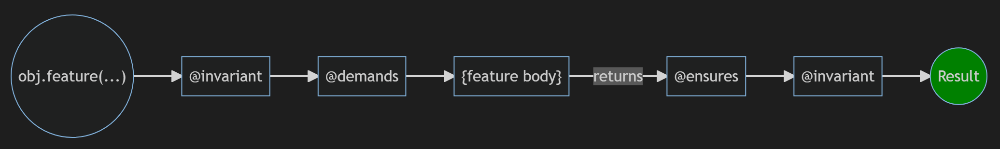

# Decorator Contracts

[](https://github.com/final-hill/decorator-contracts/actions?query=workflow%3ABuild%2FRelease)
[](https://www.npmjs.com/package/@final-hill/decorator-contracts)
[](https://www.npmjs.com/package/@final-hill/decorator-contracts)

## Table of Contents

- [Introduction](#introduction)
- [Library Installation](#library-installation)
- [Node.js version](#nodejs-version)
- [Development](#development)
- [Usage](#usage)
- [Checked Mode](#checked-mode)
- [Assertions](#assertions)
- [Implies](#implies)
- [Iff](#iff)
- [Contracts are Hoare triples](#contracts-are-hoare-triples)
- [Contract failures](#contract-failures)
- [Encapsulation](#encapsulation)
- [Invariants](#invariants)
- [Demands](#demands)
- [Ensures](#ensures)
- [Rescue](#rescue)
- [Standard Schema](#standard-schema)
- [Inspecting contracts](#inspecting-contracts)
- [The order of assertions](#the-order-of-assertions)
- [The subject a predicate is called with](#the-subject-a-predicate-is-called-with)
- [Further Reading](#further-reading)

## Introduction

Decorator Contracts is a library that provides the ability to create and assign
Code Contracts to ECMAScript and TypeScript classes. This enables
enforcement of the
[Liskov substitution principle](https://en.wikipedia.org/wiki/Liskov_substitution_principle)
of [SOLID](https://en.wikipedia.org/wiki/SOLID)
and [Organized Panic](https://en.wikipedia.org/wiki/Exception_handling#Exception_handling_based_on_design_by_contract) to support
[Design By Contract™](https://en.wikipedia.org/wiki/Design_by_contract).

Note that the license for this library is [AGPL-3.0-only](https://www.gnu.org/licenses/agpl-3.0.en.html).
You should [know what that means](https://choosealicense.com/licenses/agpl-3.0/) before
using this. If you would like an exception to this license per section 7
[contact the author](mailto:michael.haufe@final-hill.com).

## Library Installation

The latest version:

`npm install @final-hill/decorator-contracts`

A specific version:

`npm install @final-hill/decorator-contracts@x.x.x`

For use in a browser (no build step) via [unpkg.com](https://unpkg.com/):

```html
<script type="importmap">
{
    "imports": {
        "@final-hill/decorator-contracts": "https://unpkg.com/@final-hill/decorator-contracts"
    }
}
</script>
```

Via [skypack.dev](https://www.skypack.dev/):

`<script type="module" src="https://cdn.skypack.dev/@final-hill/decorator-contracts"></script>`

## Node.js version

This library requires **Node.js 26 or later**, as declared in `engines.node`. It relies on decorator metadata and targets ES2024, so an older runtime will fail at class definition rather than at an obvious call site.

## Development

A [development container](https://containers.dev/) is provided, pinned to the same Node version CI uses:

```bash
# open the repository in the container, then
npm ci          # installed automatically on create
npm run build
npm test
```

`npm ci` honours the lockfile and fails if it disagrees with `package.json`, which is what CI runs. Running `npm install` locally can rewrite the lockfile and is the usual cause of a build that passes locally and fails in CI.

| Script | Purpose |
| --- | --- |
| `npm run lint` | Lint, failing on warnings; does not modify files |
| `npm run lint:fix` | Lint and autofix |
| `npm run typecheck` | Type-check the library and the test suite |
| `npm test` | Type-check, then run the tests |
| `npm run test:coverage` | Run the tests with coverage, writing `coverage/lcov.info` |

The test suite imports the package by name, so it exercises the built `dist/` output rather than the sources. `npm test` builds first for that reason; running a single test file directly requires an existing `dist/`.

## Usage

After installation, use the decorators directly on your class methods and properties. All contracted classes must extend `Contracted` and be instantiated using the static `.new()` method.

```typescript
import {
    Contracted, demands, ensures, invariant,
} from '@final-hill/decorator-contracts';

@invariant(({ self }) =>
    self.isEmpty() == (self.size == 0) &&
    self.isFull() == (self.size == self.limit) &&
    self.size >= 0 && self.size <= self.limit
)
class Stack<T> extends Contracted {
    private _implementation: T[] = [];
    private _size = 0;
    private _limit: number;

    constructor(limit: number) {
        super();
        this._limit = limit;
    }

    get limit() { return this._limit; }
    get size() { return this._size; }

    clear(): void {
        this._implementation = [];
        this._size = 0;
    }

    isEmpty(): boolean { return this._implementation.length == 0; }
    isFull(): boolean { return this._implementation.length == this.limit; }

    @demands(({ self }) => !self.isEmpty())
    @ensures(({ self, old }) =>
        !self.isFull() && self.size == old.size - 1)
    pop(): T {
        this._size--;
        return this._implementation.pop()!;
    }

    @demands(({ self }) => !self.isFull())
    @ensures(({ self, args: [item], old }) =>
        !self.isEmpty() &&
        self.top === item &&
        self.size === old.size + 1
    )
    push(item: T): void {
        this._size++;
        this._implementation.push(item);
    }

    get top(): T | undefined {
        return this._implementation.at(-1);
    }
}

const stack = Stack.new(3);
stack.push(1);
stack.push(2);
stack.pop();
```

## Instantiation: Using the Static `.new(...)` Method

Because this library uses JavaScript `Proxy` to enforce contracts, you **must** instantiate all classes that extend `Contracted` using the static `.new(...)` method (not with `new MyClass(...)`).

This is required so that the instance is wrapped in a Proxy and invariants are asserted immediately after construction. Direct use of the `new` keyword will throw an error.

## Checked Mode

Checked Mode controls whether the contracts (invariants, demands, ensures, and rescue) are evaluated at runtime, so a production build can skip the checking cost while development and tests keep it.

It is a coarse switch, not a re-entrancy mechanism: disabling it skips contract evaluation entirely, and every member is returned unwrapped, so a feature call and a field read look the same.

**It is separate from encapsulation.** Encapsulation is the name rule: an external caller cannot assign, define, or delete a public property. It has its own switch, `[encapsulationMode]`. The two answer different questions — a test double may want the checks off while still refusing a write to a field it never declared, and a class may want the write protection without the checks.

By default both are enabled. Assign the static on a class to change it for that class and the subclasses that do not declare their own:

```typescript
import { checkedMode, Contracted, encapsulationMode } from '@final-hill/decorator-contracts';

class DataHolder extends Contracted {
    static [checkedMode] = false;          // skip the contracts
}

class OpenBox extends Contracted {
    static [encapsulationMode] = false;    // allow external writes, keep the contracts
}
```

The nearest declaration on the class chain wins, and each switch is resolved independently, so a subclass can re-enable what an ancestor disabled. A sibling or a base class that declares nothing is unaffected. Assigning on `Contracted` itself sets the default for every class that declares neither.

| | contracts on | contracts off |
| --- | --- | --- |
| **encapsulation on** | full enforcement | public writes still refused, no checks |
| **encapsulation off** | public writes allowed, checks still run on the write | neither |

Disabling encapsulation removes one verdict — whether the name may be written at all. It does not remove the write from the lifecycle: a permitted write is still an external mutation, so `@invariant` runs on entry and exit and a setter's `@demands` and `@ensures` describe it. Turning the contracts off is what removes the checks, in every quadrant.

**The switch is set on the class, never on an instance.** Assigning, defining, or deleting either symbol on an instance raises a `TypeError`, including when both switches are off — a switch a caller can set is a guarantee a caller can remove.

The switch is read on every trap rather than captured at construction, so a class assigned during a test affects instances that already exist.

One approach to managing this is to leverage environment variables. For example, you can interrogate `NODE_ENV` to decide the default:

```typescript
Contracted[checkedMode] = process.env.NODE_ENV === 'development';
```

### Interaction with `@rescue`

`@rescue` is one of the contracts, so disabling the contracts disables it: the body's own error reaches the caller and no handler runs. This is deliberate — a handler exists to translate and repair a contract failure, and with no contract failure to report there is nothing for it to act on.

Note that a `@rescue` handler cannot observe a failed `@demands` at all, whatever the switch says: a rejected precondition never enters a body. See [What a `@rescue` observes](#what-a-rescue-observes).

## Assertions

Use the `assert` function for inline assertions:

```typescript
import { assert } from '@final-hill/decorator-contracts';

function avg(xs: number[]): number {
    assert(xs.length > 0, 'The list can not be empty');
    return xs.reduce((sum, next) => sum + next) / xs.length;
}
```

If you are using TypeScript, `assert` will also assert the type of the condition:

```typescript
let str: any = 'foo';

str.toUpperCase(); // str is any

assert(typeof str == 'string');

str.toUpperCase(); // str is now a string
```

**`assert` should not be used for validating arguments**

Use the `@demands` decorator for this purpose.

## Implies

When defining predicates it is a common use case to encode [material implication](https://en.wikipedia.org/wiki/Material_conditional):

```typescript
import { implies } from '@final-hill/decorator-contracts';

implies(weather.isSunny, person.visitsBeach);
// Logically equivalent to: !weather.isSunny || person.visitsBeach
```

Both functions always return a `boolean`, even when an operand is not a boolean: a truthy object is coerced rather than passed through. Inside a contract this is redundant, because `@demands` and friends already require a literal `true` or `false` and name the offending feature.

## Iff

When defining predicates it is a common use case to encode [if and only if](https://en.wikipedia.org/wiki/Logical_biconditional):

```typescript
import { iff } from '@final-hill/decorator-contracts';

iff(person.hasTicket, person.ridesTrain);
// Logically equivalent to: implies(p, q) && implies(q, p)
```

Both functions always return a `boolean`, even when an operand is not a boolean: a truthy object is coerced rather than passed through. Inside a contract this is redundant, because `@demands` and friends already require a literal `true` or `false` and name the offending feature.

## Contracts are Hoare triples

A contract describes the **observable boundary** of a feature, in the sense of a [Hoare triple](https://en.wikipedia.org/wiki/Hoare_logic):

$$\{P\}\; C\; \{Q\}$$

`@demands` is $P$, `@ensures` is $Q$, and the feature body is $C$. Nothing inside $C$ is constrained: a body may assign to its own properties, including public ones, and may call its own features without re-entering the contracts. Correctness is the obligation that $P$ and $Q$ hold at the boundary, with the invariant additionally holding on entry and exit.

This is why there is no need to police what a body does to itself. If a body leaves the object in an invalid state, `@invariant` rejects it on exit. If it produces the wrong result, `@ensures` rejects it. Attempting to enforce correctness *inside* $C$ as well would mean the same guarantee twice, at the cost of forbidding legitimate intermediate states.

## Contract failures

A failed contract throws an `AssertionError`. Its `name` is `AssertionError` regardless of how the bundle was minified, and its message names the contract, the feature, and the predicate(s) that failed:

```text
@ensures failed for Account.withdraw (1 of 2 predicates unsatisfied: predicate #2: (self,[amount],old)=>self.balance===old.balance-amount). A postcondition was not satisfied after the feature ran.
```

The predicate text is whatever the predicate's `toString()` returns, which is minified in a bundled build. The structured `violation` below is the reliable way to identify a failure.

The error also carries a `violation` property so callers can react without parsing the message:

```typescript
import { AssertionError } from '@final-hill/decorator-contracts';

try {
    account.withdraw({ amount: 500 });
} catch (error) {
    if (error instanceof AssertionError && error.violation?.contract === '@demands') {
        // a precondition failed; the feature was never entered
    }
}
```

`violation` has the shape:

```typescript
interface ContractViolation {
    contract: '@invariant' | '@demands' | '@ensures';
    className: string;
    feature?: string;        // absent for `@invariant`
    failedIndices: number[]; // positions in the contract's composition list
    thrownIndices?: number[]; // the failing arms that threw, in evaluation order
    thrown?: string[];       // what they threw, described, aligned with `thrownIndices`
    predicates: string[];    // source text, aligned with `failedIndices`
}
```

`@demands` is OR-composed, so a failure lists **every** arm that rejected the call — any of them could have permitted it. `@ensures` and `@invariant` are AND-composed, so a failure lists only the arms that broke.

An `AssertionError` thrown by `assert()` itself has no `violation`.

### A predicate that throws is a failed predicate

A predicate that throws has answered *no*. It has not withdrawn the other arms, so evaluation continues and a later arm can still permit the call. This is what makes OR-composition hold: a subtype may weaken a precondition, and an arm that throws must not be able to deny a call its sibling allows.

```typescript
class Base extends Contracted {
    @demands(({ args: [x] }) => { if (x !== 42) throw new Denied(); return true; })
    method(x: number): number { return x; }
}

class Sub extends Base {
    @demands(({ args: [x] }) => x === 7) // a legal weakening arm
    override method(x: number): number { return x; }
}

Sub.new().method(7); // permitted: the second arm holds, so the first arm's throw is moot
```

When **every** arm fails and at least one of them threw, that thrown value is raised in place of the `AssertionError`, so a typed error reaches the caller. The **first arm that threw** decides which value that is. The structured violation is still attached to it, non-enumerable, so `error.violation` describes the contract the same way it does for a verdict; the underlying `AssertionError`, whose message names every unsatisfied arm, travels as `error.cause`:

```typescript
try {
    Sub.new().method(1); // both arms fail
} catch (error) {
    error instanceof Denied;            // true; the typed error, not an AssertionError
    error.violation.contract;           // '@demands'
    error.violation.thrownIndices;      // [0]
    error.cause.message;                // names every arm, marking the one that threw
}
```

The record describes each thrown value rather than holding it, because `ContractViolation` is otherwise plain data that a caller logs and serialises; the value itself is the error in their `catch`.

A thrown primitive is raised unchanged, since it has nowhere to carry the violation. A `TypeError` from inside a predicate — a bug rather than a decision — keeps its own class, so a caller's `catch` still branches on the bug rather than on a contract failure.

An error the contract did not create is never damaged: a frozen or non-extensible one is raised without the annotation, and a `cause` the consumer set is left alone. A contract's own `cause` never replaces one.

### Raising a typed error with `onViolation`

A predicate must not throw, so a typed error cannot be raised from inside one. `@demands` and `@ensures` therefore accept an `onViolation` factory on their options, which runs **once, after every arm has failed**, and its result is what the caller receives:

```typescript
import { Contracted, demands, type ContractViolation, type DemandsSubject } from '@final-hill/decorator-contracts';

class PermissionDenied extends Error {
    override name = 'PermissionDenied';

    constructor(message: string, readonly violation?: ContractViolation) {
        super(message);
    }
}

class Account extends Contracted {
    private _balance = 0;

    @demands(({ self }: DemandsSubject<Account>) => self._balance > 0, {
        onViolation: violation => new PermissionDenied('insufficient funds', violation),
    })
    withdraw(): void {
        this._balance--;
    }
}
```

The factory receives the full `ContractViolation`, which is the only machine-readable part of a failure. That is why the option takes a factory rather than a bare error constructor: an error boundary or a metadata-driven test needs `failedIndices`, `thrownIndices`, and the schema `issues`, and a constructor called without the violation would discard them.

The returned error carries the violation as `violation` and the `AssertionError` naming every unsatisfied arm as `cause`, both non-enumerable. A factory may supply its own `violation` and `cause`; those are kept, so an error that records what actually went wrong underneath keeps its record. The factory must return an object, since a primitive has nowhere to hold either field — that is reported as a `TypeError` naming the contract and feature, with the contract failure as its `cause`.

**Precedence across arms.** Scope is per contract, not per arm: there is no case where two arms of one contract need different error types, and per-arm would make precedence meaningless. When several arms declare a factory, the one belonging to the **first arm evaluated** decides — the same rule that makes the first passing arm decide a normalized value. Arms evaluate in the contract's composition order, so a decorator written last in source is evaluated first, and inherited arms come before a subclass's own. An arm that declares no factory defers to the next.

**When an arm also throws.** The factory still decides. A declared factory is the caller's explicit choice of error type, and it is given `thrownIndices` and `thrown`, so preferring it loses nothing.

**`@ensures` vs `@invariant`.** `@ensures` accepts the option on the same terms, with one difference at the boundary: when the body also leaves the instance invariant-invalid, the invariant failure is what the caller receives and the factory's error travels as its `cause`, because a broken instance is the state that has to surface. `@invariant` **refuses the option at decoration time**, because an invariant failure is what tells the lifecycle that the instance is in a state a `@rescue` handler must repair: the check is recognised by being an `AssertionError` whose `violation.contract` is `'@invariant'`. An error built by a factory is neither, so the repair protocol would not see it. Use a `@rescue` handler instead — it observes a failure a feature raised and can raise a typed error of its own.

That route covers the entry and exit checks only. The invariant `Contracted.new()` evaluates before it proxies the instance is outside every handler, so a class whose initial state violates an invariant reports an untyped `AssertionError`.

`checkedMode` disables the factory along with the contract, since a contract that does not run cannot fail.

## Encapsulation

Encapsulation governs the **external surface**. Public property assignment is forbidden from outside a contracted class, so a caller cannot mutate state without a postcondition to catch it. All interactions must go through a method or getter/setter, and only properties starting with `_` (conventionally private) can be assigned to after construction.

```typescript
class Example extends Contracted {
    _private = 1; // Allowed
    publicProp = 2; // Not allowed from outside
}
```

The boundary begins *after* construction. A constructor runs before the instance is proxied, so its assignments — to public properties included — are unrestricted. That is deliberate: field initialisers and `Object.assign(this, ...)` are ordinary ways to establish initial state, and the invariant evaluated at the end of `Contracted.new()` is what validates the result.

```typescript
class Example extends Contracted {
    publicProp = 2;             // allowed: field initialiser
    constructor() {
        super();
        this.publicProp = 3;    // allowed: still inside construction
    }
}
```

An external write to a public property raises a `TypeError`:

```typescript
const example = Example.new();

example.publicProp = 3; // TypeError
```

A feature body is $C$ and is **not** subject to this rule. It runs against the instance directly, so internal state — public or private — is its own business:

```typescript
class Example extends Contracted {
    publicProp = 1;

    update(): void {
        this.publicProp = 2; // allowed; `@ensures` and `@invariant` are the guarantee
    }
}
```

A method calling another method of the same instance likewise does not start a second contract lifecycle. The enclosing invocation owns the assertions, so the invariant is evaluated once on entry and once on exit regardless of how many internal accesses the body performs.

One consequence: a body that leaks `this` outward — passing it to a callback, storing it in a module-level variable, or returning it — hands out a reference that bypasses the traps. Do not do that; expose an explicit API instead.

### Deletion

Deletion is an external mutation, so it follows exactly the same rule as assignment: `_`-prefixed properties may be deleted, public properties may not, and the invariant is evaluated around the deletion.

| Expression | Result |
| --- | --- |
| `delete example._private` | allowed |
| `delete example.publicProp` | `TypeError` |
| `delete example.nonexistent` | `TypeError` (the name is not `_`-prefixed) |

The last row surprises people, but it is the same rule `set` applies to an assignment of a property that does not exist: the restriction is on the *name*, not on whether the property is present. Once checked mode is disabled the proxy steps aside and `delete` behaves as it does on a plain object.

### Property definition

Defining a property is the same kind of external mutation as assigning one, so it follows the same rule: only `_`-prefixed names may be defined, and `Object.defineProperty`, `Reflect.defineProperty`, and `Object.defineProperties` are all intercepted.

This matters because definition can do more than assignment. Redefining a public field escapes the postcondition that would have caught the change, and replacing a contracted **method** routes callers around its `@demands` and `@ensures` entirely:

```typescript
const example = Example.new();

Object.defineProperty(example, 'publicProp', { value: 3 }); // TypeError
Object.defineProperty(example, 'guard', { value: () => 1 }); // TypeError
```

A **prototype setter does not authorise defining the same name**, unlike assignment. Assignment invokes the setter, which is the sanctioned route; defining an own property shadows the accessor instead of invoking it, so it is refused.

Two operations remain available for every property name, because neither changes nor shadows state:

| Expression | Result |
| --- | --- |
| `Object.freeze(example)` | allowed (seals each existing property) |
| `Object.seal(example)` | allowed |
| `Object.preventExtensions(example)` | allowed (no property definition involved) |

Once an instance is frozen, a write it cannot accept **throws**, rather than being reported as a successful assignment.

### Replacing the prototype

`Object.setPrototypeOf` and `Reflect.setPrototypeOf` throw. A replacement changes which descriptors a feature resolves to, which would leave the instance running methods that do not match the contracts it reports.

## Asynchronous features

A feature declared `async` is fully contracted. Because an `async` body returns its promise before a single line of it has run, the exit boundary follows the value: `@ensures` and the exit `@invariant` are evaluated after the promise settles, against the state the body actually reached.

```typescript
class Account extends Contracted {
    protected _balance = 0;
    public _ledger!: Ledger;                 // a collaborator the caller sets
    get balance() { return this._balance; }

    @demands(({ self, args: [amount] }) => self.balance + amount >= 0)
    @ensures(({ self, args: [amount], old }) => self.balance === old.balance + amount)
    async deposit(amount: number): Promise<void> {
        await this._ledger.record(amount);   // suspension happens here
        this._balance += amount;              // observed by @ensures
    }
}
```

The lifecycle is unchanged in order and in count: `@invariant` -> `@demands` -> body -> `@ensures` -> `@invariant`, with the invariant evaluated twice per call. Only the *position* of the exit checks differs, because the body has not finished until the promise settles. A `@rescue` observes rejections as it observes synchronous throws, and `retry` restarts the lifecycle for an asynchronous feature too.

### Failure is delivered as a rejection

A contract violation on an `async` feature reaches the caller as a rejected promise, never as a synchronous throw — the same way the feature's own errors reach it. Adding a contract to a feature must not change how its failures are observed.

```typescript
await assert.rejects(() => account.deposit(-5));  // AssertionError, not a sync throw
```

This follows from substitutability. `() => T` and `() => Promise<T>` are mutually non-assignable in TypeScript, so neither is a subtype of the other and no sync/async conversion is implied. What must hold is the observable surface: a caller of the undecorated feature receives a promise that may reject, so a caller of the contracted feature must receive the same.

### A synchronous feature must not return a promise

Contracts on a feature that is not declared `async` are evaluated when its body returns. A body that defers its work through a promise would therefore be checked before it has done anything, so this is rejected:

```typescript
@ensures(...)
thenable(): Promise<void> {           // AssertionError: not declared 'async'
    return (async () => { await work(); this._value++; })();
}
```

Declare the feature `async` instead. Awaiting arbitrary thenables was rejected as a rule because it would make the `async` keyword optional while silently changing when failures are reported: a plain function cannot return pending work *and* raise the resulting failure itself.

### Generators

A generator has a contract boundary per **step**, not one per call. Calling the feature runs nothing; each `next()` runs the body from where it was suspended up to the following `yield`. When `next()` returns the segment has finished and the instance holds the state it will be observed with, so the contracts bracket each step:

```text
call    -> @invariant, @demands      the call arguments are P
next()  -> @invariant                entry of the step
segment -> body up to the next yield
next()  -> @ensures, @invariant      the yielded value and the new state are Q
```

This is the same sandwich shown above, applied once per step. A yield is the observable delivery of a traversal, which is what `@ensures` describes, so every yielded value must satisfy it:

```typescript
class Counter extends Contracted {
    protected _count = 0;

    @ensures(({ self, args: [_value], old }: EnsuresSubject<Counter, [number], unknown>) => self._count === old._count + 1)
    *tick(): Generator<number> {
        this._count++; yield this._count;   // each step is checked
        this._count++; yield this._count;
    }
}
```

The `old` snapshot is per step, not per traversal: it describes the state the segment is about to change. A `return` value is not covered by `@ensures`, because nothing is yielded.

#### Why the invariant runs on every resume

A suspended generator's instance is publicly reachable, so another feature can be called on it between yields. Checking the invariant only at completion would leave the object knowingly invalid for the whole traversal, and would never check at all if the iterator were abandoned or only partially drained. Evaluating it on each resume is what keeps the guarantee every other feature already has: no public interaction leaves the object invalid.

```typescript
const iterator = ledger.payments();
iterator.next();         // segment 1 checked on exit
ledger.audit();          // a public call, and it sees a valid object
```

#### `@demands` describes the call

`@demands` runs once, on the first step: there is one call, so there is one precondition. A later step may also be *given* a value through `next(value)`, which becomes the value of the preceding `yield` expression and is not an argument of the call; that input is checked as a precondition **when it is present**. `for...of` iterates with `next()` and injects nothing, so it never re-enters the precondition with `undefined`:

```typescript
@demands(({ args: [count] }) => count > 0)
*gen(count: number): Generator<number> { /* ... */ }

for (const value of obj.gen(3)) { /* works: no value is injected */ }
```

#### `@rescue` covers the traversal

A generator that has already been consumed cannot be resumed from the beginning, so `retry` restarts the traversal, rerunning the body exactly as it does for an ordinary feature. A throw escaping a step is what the handler observes.

## Note on Private Fields and Accessors

Due to the use of JavaScript `Proxy` in the implementation of this library, native `#private` fields and the `accessor` keyword are **not supported**. Instead, use conventional private fields (e.g., `_private`) and define explicit getter/setter pairs for encapsulation:

```typescript
class Example extends Contracted {
    private _value = 0;
    get value() { return this._value; }
    set value(v: number) { this._value = v; }
}
```

Do **not** use:

- `#privateField` syntax
- `accessor foo` syntax

These will not work correctly with the contract enforcement provided by this library.

## Invariants

Use the `@invariant` decorator on your class to enforce relationships between properties and methods. The invariant is checked after construction, before and after every method execution, and before and after every get/set usage.

```typescript
@invariant(({ self }) => self.value >= 0)
class Foo extends Contracted {
    protected _value = 0;
    get value() { return this._value; }
    set value(v: number) { this._value = v; }

    inc(): void { this.value++; }
    dec(): void { this.value--; }
}
```

### Contract predicates must return a boolean

`@invariant`, `@demands`, and `@ensures` predicates must return `true` or `false`. The result is not coerced: a non-boolean result raises an `AssertionError` naming the contract, the feature, and which predicate in the composition failed.

```typescript
@demands(() => Promise.resolve(true))  // AssertionError: returned a Promise
```

This is deliberate. A `Promise` is always truthy, so coercing the result would silently treat an accidentally asynchronous predicate — one that has not actually checked anything yet — as a satisfied contract. Failing closed is the only safe option, and the message points at the mistake.

Asynchronous *predicates* are therefore not supported: a predicate that needs the result of an asynchronous operation cannot be expressed as a boolean.

Asynchronous *features* are supported; see [Asynchronous features](#asynchronous-features).

### Contract predicates may not change the instance

A predicate answers a question, so it cannot change the state it is asked about. `@invariant`, `@demands`, and `@ensures` receive a **read-only view** of the instance: assigning, deleting, or defining a property raises a `TypeError` naming the property.

```typescript
@demands(({ self }) => { self._value = 0; return true; })
// TypeError: A contract predicate may not assign '_value'.
```

This matters because a predicate runs *between* the entry and exit `@invariant`. A write inside a predicate can therefore hide a violation the invariant would otherwise have reported, turning a detectable bug into a silent one.

```typescript
@invariant(({ self }) => {
    self._value = 0;          // would repair the state being checked
    return self._value >= 0;  // and then pass
})
```

`@rescue` is deliberately **not** restricted. Restoring corrupted state is its purpose, so its handler receives the raw instance.

#### What is not blocked

The guard covers the instance's own surface. A mutation *through* a nested value still reaches the shared object:

```typescript
@demands(({ self }) => { self._items.push(item); return true; })  // not intercepted
```

Closing that would mean deep-wrapping every value a predicate reads, which changes object identity and would break legitimate comparisons such as `old.child === self.child`. The guarantee is therefore "a predicate cannot assign to the instance", which is the case that corrupts contract evaluation.

The feature body is unaffected: it still receives the instance itself and mutates freely. The view is scoped to the predicate call, which is why a scoped `Proxy` is used rather than `Object.freeze` — freezing is permanent, and would leave the body unable to change anything afterwards.

### Subcontracting and Invariants

When subclassing, if a subclass defines its own `@invariant`, the resulting invariant is **strengthened**: the subclass invariant and the base class invariant are both enforced (they are logically AND-ed together). This means all invariants in the inheritance chain must hold for the object to be valid.

```typescript
@invariant(({ self }) => self.value >= 0)
class Base extends Contracted {
    // ...
}

@invariant(({ self }) => self.value <= 10)
class Sub extends Base {
    // ...
}
// The effective invariant for Sub is: (self.value >= 0) && (self.value <= 10)
```

## Demands

Use the `@demands` decorator to specify preconditions for methods or get/set. If the condition fails, an error is thrown before the method executes.

```typescript
class Foo extends Contracted {
    protected _value = 0;
    get value() { return this._value; }
    set value(v: number) { this._value = v; }

    @demands(({ self }) => self.value >= 0)
    dec(): void { this.value--; }
}
```

### Subcontracting and Demands

When subclassing, if a subclass defines its own `@demands` for a method, the resulting precondition is **weakened**: the subclass and base class demands are OR-ed together. The method can be called if **any** of the demands in the inheritance chain are satisfied.

```typescript
class Base extends Contracted {
    @demands(({ args: [x] }) => x >= 0)
    foo(x: number) { /* ... */ }
}

class Sub extends Base {
    @demands(({ args: [x] }) => x === 42)
    override foo(x: number) { /* ... */ }
}
// The effective demand for Sub#foo is: (x >= 0) || (x === 42)
```

A demand is called with a `DemandsSubject`: `{ self, args }`. `args` is the
**argument list** of the invocation, so destructure it inside the parameter:
`({ args: [x] }) => x >= 0`. Writing `({ args }) => args >= 0` does not compile,
because `args` is the array rather than the first argument.

A predicate takes one object rather than a positional list, so the shape it
expects is visible where it is declared: a predicate that reads only `self` is
written `({ self }) => ...`, and the parameter list says so. The runtime supplies
every field listed above whether or not the predicate destructures it.

## Ensures

Use the `@ensures` decorator to specify postconditions for methods or get/set. If the condition fails, an error is thrown after the method executes.

```typescript
class Foo extends Contracted {
    protected _value = 0;
    get value() { return this._value; }
    set value(v: number) { this._value = v; }

    @ensures(({ self }) => self.value >= 0)
    dec(): void { this.value--; }
}
```

### The `old` instance

A postcondition receives `old`, a snapshot of the instance taken immediately before the feature ran. `old` inherits from the instance, so prototype getters and methods remain usable, and reading a prototype getter on `old` returns the historical value:

```typescript
class Counter extends Contracted {
    protected _n = 0;
    get n() { return this._n; }

    @ensures(({ self, old }) => self.n === old.n + 1)
    inc(): void { this._n++; }
}
```

Own state is copied, so mutations made by the feature body are not visible through `old`. The copy is deep for the containers contracts routinely compare:

| Value | Behaviour in `old` |
| --- | --- |
| Primitives | copied |
| Arrays | cloned recursively |
| `Date` | cloned |
| `Map`, `Set` | cloned (keys and values recursively) |
| Plain objects | cloned recursively, including cycles |
| Class instances | **shared by reference** |
| Functions | **shared by reference** |

Class instances and functions are shared deliberately. They carry behaviour, so a structural copy would produce an object that is not a real instance of its class, and many cannot be cloned meaningfully at all. The consequence is that mutating a class instance held in a field *is* visible through `old`; if a postcondition depends on such an object's previous state, copy it explicitly in the predicate.

Accessors are copied as descriptors rather than evaluated, so snapshotting never invokes a getter.

### Subcontracting and Ensures

When subclassing, if a subclass defines its own `@ensures` for a method, the resulting postcondition is **strengthened**: the subclass and base class ensures are AND-ed together. The method's result must satisfy **all** ensures in the inheritance chain.

```typescript
class Base extends Contracted {
    @ensures(({ args: [x] }) => x >= 0)
    foo(x: number) { /* ... */ }
}

class Sub extends Base {
    @ensures(({ args: [x] }) => x <= 10)
    override foo(x: number) { /* ... */ }
}
// The effective ensures for Sub#foo is: (x >= 0) && (x <= 10)
```

A postcondition is called with an `EnsuresSubject`: `{ self, args, old, result }`.
`args` is the argument list, `old` is the snapshot of the instance from before the
feature ran, and `result` is the value the feature produced. Destructure the
fields the predicate reads; the runtime supplies the rest unused.

### The `result`

A postcondition receives `result`, the value the feature returned:

```typescript
class Proposal extends Contracted {
    protected _state = 'Draft';
    get state() { return this._state; }

    @ensures(({ result }: EnsuresSubject<Contracted, any[], any>) => result.state === 'Proposed')
    submit(): Proposal {
        this._state = 'Proposed';
        return this;
    }
}
```

For a getter, `result` is the value the getter returned. For an `async` feature
it is the settled value, so the postcondition observes the promise's resolution
rather than the promise. For a generator it is the value yielded by the step being
checked, because a generator's boundary is per step.

A rejected `async` feature has no value to describe, so `@ensures` does not run for
it; the rejection reaches the caller (or `@rescue`) directly. The same holds for a
getter that returns a promise, which is refused as an `async` mistake before any
postcondition is evaluated: `result` is therefore the value a *synchronous* getter
returned.

Every arm receives the **same** result: the raw value the body produced. A
normalizing schema arm validates that value and only then replaces what the caller
receives, so a predicate and a normalizing schema in one composition agree about
what they were shown. `result` is therefore *not* the post-normalization value.

A write has no value to deliver, so for a setter `result` is the value that was
assigned.

## Rescue

Use the `@rescue` decorator to handle exceptions thrown by a method, restore invariants, or retry execution:

```typescript
import { Contracted, rescue } from '@final-hill/decorator-contracts';

class Example extends Contracted {
    private _value = 3;
    get value() { return this._value; }
    set value(v) { this._value = v; }

    @rescue(({ self }) => self.value = 5)
    method1(): void { throw new Error('I am error'); }
}
```

You can also use the `retry` function in your rescue handler to attempt the method again:

```typescript
class Example extends Contracted {
    @rescue(({ retry }) => retry(3))
    method(value: number): number {
        if (value <= 0)
            throw new Error('value must be greater than 0');
        else
            return value;
    }
}
```

`retry` passes **only** the arguments you give it — it does not replay the original arguments. To retry with the same arguments, forward the `args` you received:

```typescript
@rescue(({ args, retry }) => retry(...args))
```

Calling `retry()` retries with no arguments.

A `@rescue` handler **cannot supply the feature's result**. Only `retry` can produce one, by running the body again; a value returned from the handler is ignored, and the original error is raised to the caller when `retry` is not called. To recover with a substitute value, restructure the body to accept the alternative and retry with it:

```typescript
@rescue(({ args, retry }) => {
    // the handler restores state, then asks for a second attempt
    retry(...args);
})
method(value: number): number { /* ... */ }
```

This keeps the postcondition meaningful: a result the body never produced would not be covered by `@ensures`.

### What a `@rescue` observes

A handler is the place to repair an instance, so it sees every failure that leaves state worth repairing:

| Failure | Reaches the feature's own `@rescue`? |
| --- | --- |
| the body throws | **yes** |
| own `@ensures` fails | **yes** |
| own `@invariant` fails, on entry or exit | **yes** |
| own `@demands` fails | **no** |

The last row is deliberate. A precondition rejects a call that has not begun, so there is no body to resume, and a handler that retried with an argument the precondition also rejects would recurse without end. A failed precondition therefore reaches the caller directly.

The third row is what makes a broken instance recoverable. Once an instance fails its invariant, every accessor throws on exit, so without this a handler could not even reach the state it would fix:

```typescript
import nodeAssert from 'node:assert/strict';
import { Contracted, invariant, rescue } from '@final-hill/decorator-contracts';

@invariant(({ self }) => self._balance >= 0)
class Account extends Contracted {
    public _balance = 1;
    @rescue(({ self }) => { self._balance = 0; })
    withdraw(amount: number): void { this._balance -= amount; }
}

const account = Account.new();
nodeAssert.throws(() => account.withdraw(5), /@invariant failed/); // overdrawn
account._balance;                                                  // 0 — usable again
```

The call still fails, because `@rescue` resumes a body and this one has already run. What the handler buys is an instance that is valid again, which a later `retry` can use.

A getter or setter behaves the same way: the handler runs and can repair the instance, but the access is not resumed, because an accessor has no body to re-run. A handler that repairs a getter's state therefore leaves the instance usable without that particular read succeeding.

A handler is called **before** the invariant is re-tested, so it can repair the state rather than being denied the attempt. That means a handler observes the error that failed, which is the body's own error when the body threw.

When nothing has repaired the instance, the invariant failure supersedes the original on the way to the caller, and the original travels as `cause`:

```typescript
import { Contracted, invariant } from '@final-hill/decorator-contracts';

@invariant(({ self }) => self._balance >= 0)
class Account extends Contracted {
    public _balance = 1;

    withdraw(amount: number): void {
        this._balance -= amount;
        if (this._balance < 0) throw new Error('insufficient funds');
    }
}

try {
    Account.new().withdraw(5);   // body throws, and leaves the balance negative
} catch (error: any) {
    error.violation.contract;    // '@invariant'
    error.cause.message;         // 'insufficient funds'
}
```

A handler that repairs the state before declining to retry prevents that: the instance is valid by the time the invariant is re-tested, so the body's own error is what the caller receives.

Because a handler runs before the invariant is re-tested, it receives the error that failed rather than the invariant failure that may supersede it. A per-feature handler knows which feature it was attached to, so that is unambiguous; a class-level handler would not, and the [class-level `@rescue`](https://github.com/final-hill/decorator-contracts/issues/344) design has to settle what context such a handler receives.

### Retry bounds

`retry` restarts the body, so it can always be attempted again. The one boundary that cannot be restarted is the *entry* check: nothing has run yet, so a retry can only re-check the state the handler just set. That repair is attempted **once**; if the invariant still fails, the failure is raised rather than looping, because every further attempt would fail identically.

Everywhere else, retries are unbounded by default and `maxRetries` bounds them, as described under [N-Version programming](#robustness-organized-panic-and-the-benefits-of-rescue). An unbounded handler that never repairs will therefore loop until it does — that is the price of allowing a handler to choose the next alternative.

### Robustness, Organized Panic, and the Benefits of `@rescue`

The `@rescue` decorator enables a mechanism for **Robustness** in your code. It allows your implementation to respond to situations not specified, providing the ability to handle exceptions in a structured way. This is sometimes called **Organized Panic**.

In addition, `@rescue` provides a foundation for **N-Version programming**, **Fault-Tolerance**, and **Redundancy**. You can implement multiple strategies for handling errors, retrying with alternative logic or data, and ensuring your application can recover from unexpected failures.

A retried invocation re-enters the full assertion lifecycle (`@invariant` -> `@demands` -> body -> `@ensures`), and if it fails again the `@rescue` handler runs again. This means the handler is executed once per attempt, which is what N-Version programming requires: each invocation of the handler can select the next alternative.

A dated example of this is performing ajax requests in a multi-browser environment:

```typescript
import { Contracted, rescue } from '@final-hill/decorator-contracts';

declare function legacyGet(url: string): string;
declare function activeXGet(url: string): string;
declare function xhrGet(url: string): string;
declare const window: any;

class AjaxRequest extends Contracted {
    private _version = 0;
    private _versions = ['legacy', 'activex', 'xhr'] as const;

    @rescue(({ self, args, retry }) => {
        self._version++;
        retry(...args);
    }, { maxRetries: 2 })
    get(url: string): string {
        const version = this._versions[this._version];

        switch (version) {
            case 'legacy':
                if (!window.XMLHttpRequest) throw new Error(`${version} unsupported`);
                return legacyGet(url);
            case 'activex':
                if (!window.ActiveXObject) throw new Error(`${version} unsupported`);
                return activeXGet(url);
            default:
                return xhrGet(url);
        }
    }
}
```

Because a rescue handler may retry unconditionally, retries are unbounded by default. Set the `maxRetries` option on the `@rescue` declaration to bound them; when the limit is reached the last error is raised to the caller:

```typescript
@rescue(({ args, retry }) => retry(...args), { maxRetries: 3 })
```

The option belongs to the declaration because the number of alternatives is a property of the feature, not of an individual failure. It is enforced per invocation of the feature, so a single call performs at most `maxRetries` retries however many `@rescue` executions that involves.

Unlike traditional `try/catch`, where exceptions are non-resumable and often handled far from the source (leading to scattered and redundant error handling), `@rescue` allows for **resumable exceptions** and localized, declarative error handling. This means:

- You can lexically determine where exception handling occurs.
- You can restore invariants or perform corrective actions before retrying or failing.
- You can optionally call `retry` to attempt the method again with new arguments or after fixing state, providing a form of fault tolerance and robustness.
- You can implement alternative strategies for error recovery, supporting N-Version programming and redundancy.

**Inheritance:**

If a base class declares a `@rescue` handler for a method, that handler is inherited by subclasses unless the subclass overrides it with its own `@rescue` declaration. This ensures that robust error handling is preserved throughout the inheritance chain, unless explicitly changed.

This approach leads to more maintainable and robust code, as error handling is organized and closely tied to the contract of the class feature, rather than being scattered throughout the call stack.

## Standard Schema

`@invariant`, `@demands`, and `@ensures` accept a [Standard Schema V1](https://github.com/standard-schema/standard-schema) value anywhere they accept a predicate. Zod, Valibot, ArkType, and Effect Schema are then interchangeable: the library consumes the protocol and never depends on a provider.

```typescript
import { z } from 'zod';
import { Contracted, demands, ensures } from '@final-hill/decorator-contracts';

const positive = z.number().positive();
const quantity = z.tuple([z.number().positive()]);

class Inventory extends Contracted {
    protected _stock = 0;
    get stock() { return this._stock; }

    @demands(quantity)                       // validates the argument tuple
    @ensures(positive)                       // validates the result
    add(...[count]: [number]): number {
        this._stock += count;

        return this._stock;
    }
}
```

### What a schema validates

The subject is the subject the contract already describes, so the two kinds of arm are interchangeable:

| Decorator | A schema validates | A predicate receives | Composition |
| --- | --- | --- | --- |
| `@invariant` | the instance | `(self)` | AND |
| `@demands` | the **argument tuple** | `(self, args)` | OR |
| `@ensures` | the **result** | `(self, args, old)` | AND |

Because `@demands` validates the argument tuple rather than the first argument, a one-parameter method is written as a tuple of one (`z.tuple([...])`). This keeps the subject unambiguous for any arity, and it is what makes an issue's `path` point at the argument that failed.

A schema is the subject for the contract, not for the feature it happens to guard: `@demands` takes the tuple, `@ensures` takes the result, `@invariant` takes the instance. Declaring the tuple once and sharing it keeps that true across every feature with the same shape:

```typescript
const quantity = z.tuple([z.number().positive()]);

class Inventory extends Contracted {
    @demands(quantity) add(count: number): number { /* ... */ }
    @demands(quantity) remove(count: number): number { /* ... */ }
}
```

### `normalize` and `@invariant`

`normalize` replaces the contract's subject with the schema's output, which is meaningful where the subject is something the runtime can substitute: the arguments for `@demands`, and the result for `@ensures`.

An invariant's subject is the instance, and nothing replaces it. `normalize` is therefore **refused at decoration time**, for either kind of arm:

```text
@invariant cannot normalize: its subject is the instance, which no arm can replace.
```

The option is refused for what it would do rather than for appearing, so
`normalize: false` is still accepted.

### Composition follows variance

The rules above are the substitution rules, not a convention:

- **`@demands` is contravariant.** A subtype may accept *wider* input, so conditions are OR-composed and any inherited arm satisfies the call. A subtype adding an arm therefore **weakens** the precondition.
- **`@ensures` and `@invariant` are covariant.** A subtype may promise *narrower* output and must preserve *more* state, so conditions are AND-composed and every arm must hold. A subtype adding an arm therefore **strengthens** the obligation.

A schema arm composes exactly like a predicate arm, which is why no separate decorators exist: the rule belongs to the contract, not to the kind of arm.

**A narrowing subtype precondition has no effect, and that is correct.** Writing `@demands(z.number().min(5))` in a subtype does not restrict anything, because OR-composition keeps the inherited arm. A subtype is not permitted to narrow what its supertype accepts, so the runtime refuses to give it that power. TypeScript will not catch the mistake either — **method parameters are bivariant** under `strictFunctionTypes` — so this is a review obligation. Declare input schemas on the base feature.

### Failure reporting

A schema failure carries the provider's own `issues` in the structured payload, and renders them into the message:

```typescript
try {
    inventory.add(-1);
} catch (error) {
    error.violation?.contract;   // '@demands'
    error.violation?.issues;     // ReadonlyArray<{ message, path? }>
}
```

One consequence of validating the argument tuple is that an issue's `path` is also relative to it, so the first argument is index `0`:

```text
@demands failed for Shipping.send (1 of 1 schema unsatisfied: schema #1: ...).
Reported: 0.zip: Invalid string: must match pattern /^\d{5}$/.
```

### Normalization is opt-in

`validate` may transform its input. Applying that transformation changes what the body receives and what later contracts observe, so it is an explicit choice:

```typescript
@demands(trimmedName, { normalize: true })
rename(name: string): void { /* receives the trimmed name */ }
```

- **`@demands`** is OR-composed, so the **first passing arm** decides the normalized value. That is deterministic and matches evaluation order.
- **`@ensures`** is AND-composed, so two normalizing arms would disagree about what the caller receives. That is refused at decoration time rather than resolved arbitrarily.

Off by default: without `normalize`, a schema only reports a verdict.

### Synchronous only

Contract evaluation is synchronous, so a `validate` that returns a Promise is refused with a message asking for a synchronous schema. Treating a pending validation as satisfied would be worse than failing, and awaiting would move the feature's boundary.

### No type inference

Decorators cannot change a feature's signature, so a schema gives **runtime enforcement only**: it neither narrows the declared parameter types nor infers `Input`/`Output`. Accurate inference needs a builder API, which this library does not have.

### Providers

Any implementation of the protocol works, and no provider is a dependency. The `StandardSchemaV1` types are exported if you want to annotate your own schemas:

```typescript
import type { StandardSchemaV1 } from '@final-hill/decorator-contracts';
```

## Inspecting contracts

`getContractMetadata(Class)` reports the contracts a class declares, and
`getFeatureContracts(Class, feature)` reports the arms that apply to one feature
in the order they are evaluated. Use them instead of reading `Contracted[Symbol.metadata]`
directly: the symbol holds the record the runtime consults, so a consumer who edits
it edits their own class's contracts. The accessors return frozen copies.

This is what turns "every public verb declares a precondition" into one
architectural test rather than one test per verb:

```typescript
import {
    Contracted, getContractMetadata, getFeatureContracts, demands,
} from '@final-hill/decorator-contracts';

class Repository extends Contracted {
    public _connected = true;
    get connected() { return this._connected; }

    @demands(({ self }) => self.connected)
    read(_id: string): unknown { return { id: _id }; }
}

const metadata = getContractMetadata(Repository);

metadata.invariants;                  // every class-level arm
metadata.demands['read'].length;     // 1: the arms declared for `read`
getFeatureContracts(Repository, 'read').demands.length;  // 1
```

The lists are already **effective**: a subclass's record contains its own
declarations and the inherited ones, so there is no prototype chain to walk. The
order is the evaluation order — inherited arms first, then the class's own, and
within one class in **reverse source order**, because decorators evaluate
bottom-up.

A class that declares nothing has no record at all, so both accessors report empty
lists rather than `undefined`.

### The stability guarantee

The shape of `ContractMetadata` and `FeatureContracts` is stable for the major
version: fields may be added, but an existing field will not change meaning
without one. The *arms* are whatever you declared — a predicate, a schema, and the
options passed alongside it — so their identity is preserved and comparing an arm
against the one you wrote works.

## The order of assertions

When `obj.feature` is called the happy path is:



The invariant is evaluated **twice** per successful call: once on entry and once on exit. Each of `@demands`, the feature body, and `@ensures` runs once. Accessors follow the same lifecycle as methods, and an accessor that reads another accessor or calls a method does not start a nested lifecycle.

An `async` feature follows the same order with the exit checks moved after the promise settles, so they observe the state the body actually reached; its failures reach the caller as a rejection. A generator applies the same order **once per step**, as described in [Generators](#generators).

The entry check is not redundant with `Contracted.new()`. Object state can be corrupted without going through a checked feature — via `Object.defineProperty`, by running with checked mode disabled and re-enabling it, or internally from a feature body. The entry check is what turns that into a precise error at the next public interaction rather than letting an invalid object keep operating.

Because the invariant is checked first, an invalid object reports its invariant violation rather than a precondition failure. That ordering is deliberate: the object is broken in a way that makes the caller's arguments moot.

If an error is thrown and there is no `@rescue` defined then the `@invariant` is checked before the error is raised to the caller. If the instance has become invalid, that invariant failure is what reaches the caller, with the original error as its `cause`.

If an error is thrown in the `@invariant` then the `@rescue` is executed, so a handler can restore the state. Without a handler, or once its attempts are spent, the failure is raised to the caller.

If an error is thrown in the `@demands` then the error is raised to the caller, and `@rescue` is not consulted. A precondition rejects a call that has not begun, so there is no body to resume. The exit `@invariant` is not checked either, because the feature body has not been entered and the instance cannot have changed.

If an error is thrown by the feature body or the `@ensures` then the `@rescue` is executed. If `retry` is called then the process starts from the beginning.

If the retried invocation fails, its `@rescue` is executed again, so the handler runs once per attempt. Retries are bounded by the `maxRetries` option; without it they are unbounded.

If `@rescue` throws an error or does not call `retry` then the `@invariant` is checked before the error is raised to the caller.


## The subject a predicate is called with

Every contract calls its predicate with a single object. Destructuring is what
makes the shape visible at the declaration, and it keeps every declaration to one
parameter so a `max-params: 1` configuration is satisfied.

| Contract | Subject fields |
| --- | --- |
| `@demands` | `{ self, args }` |
| `@ensures` | `{ self, args, old, result }` |
| `@invariant` | `{ self }` |
| `@rescue` | `{ self, error, args, retry }` |

Bind the fields a predicate reads and omit the rest; the runtime supplies them all
whether or not the parameter list names them. A predicate that destructured its
arguments as `[x]` writes `({ args: [x] }) => x > 0`, so the body is unchanged.

The compiler rejects a parameter list that does not line up with the subject.
A two-parameter leftover fails with *Target signature provides too few arguments*:
`(self: Cart, [x]: [number]) => ...`. A one-parameter leftover is rejected
because the instance is not assignable to a `DemandsSubject`: `(self: Cart) =>
...`. Parameters typed `any` are the one case the compiler cannot check, and such
a predicate receives the subject object where it expects the instance.

`retry` is a field of the subject, so a handler that forwards its arguments
writes `({ args, retry }) => retry(...args)`.

The subject is **inferred**, so a predicate that reads instance state usually needs
no annotation at all:

```typescript
@demands(({ self, args }) => self.total + args[0] >= 0)  // `self` is the class, `args` is the call tuple
```

An annotation is only needed when the runtime subject differs from the call
signature. The one place that happens is a generator's `@ensures`, whose `args` is
the value the step yielded rather than the call arguments:

```typescript
@ensures(({ args: [yielded] }: EnsuresSubject<Counter, [number]>) => ...)
```

`result` always stays `unknown`, because a method's return type and a getter's
property type are both inference sites for it and the compiler would resolve it to
their intersection. Name it on the subject when a predicate needs more.

## Further Reading

- [Design by Contract](https://en.wikipedia.org/wiki/Design_by_contract)
- [Liskov Substitution Principle](https://en.wikipedia.org/wiki/Liskov_substitution_principle)
- [Object-Oriented Software Construction](https://en.wikipedia.org/wiki/Object-Oriented_Software_Construction)
