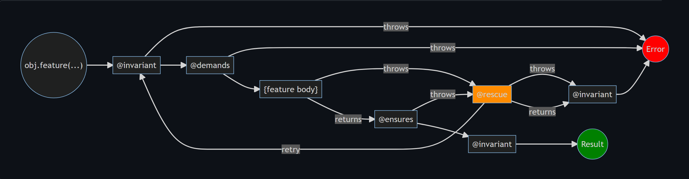

# Decorator Contracts

[](https://github.com/final-hill/decorator-contracts/actions?query=workflow%3ABuild%2FRelease)
[](https://www.npmjs.com/package/@final-hill/decorator-contracts)
[](https://www.npmjs.com/package/@final-hill/decorator-contracts)

## Table of Contents

- [Introduction](#introduction)
- [Library Installation](#library-installation)
- [Node.js version](#nodejs-version)
- [Development](#development)
- [Usage](#usage)
- [Checked Mode](#checked-mode)
- [Assertions](#assertions)
- [Implies](#implies)
- [Iff](#iff)
- [Contracts are Hoare triples](#contracts-are-hoare-triples)
- [Contract failures](#contract-failures)
- [Encapsulation](#encapsulation)
- [Invariants](#invariants)
- [Demands](#demands)
- [Ensures](#ensures)
- [Rescue](#rescue)
- [Standard Schema](#standard-schema)
- [The order of assertions](#the-order-of-assertions)
- [Further Reading](#further-reading)

## Introduction

Decorator Contracts is a library that provides the ability to create and assign
Code Contracts to ECMAScript and TypeScript classes. This enables
enforcement of the
[Liskov substitution principle](https://en.wikipedia.org/wiki/Liskov_substitution_principle)
of [SOLID](https://en.wikipedia.org/wiki/SOLID)
and [Organized Panic](https://en.wikipedia.org/wiki/Exception_handling#Exception_handling_based_on_design_by_contract) to support
[Design By Contract™](https://en.wikipedia.org/wiki/Design_by_contract).

Note that the license for this library is [AGPL-3.0-only](https://www.gnu.org/licenses/agpl-3.0.en.html).
You should [know what that means](https://choosealicense.com/licenses/agpl-3.0/) before
using this. If you would like an exception to this license per section 7
[contact the author](mailto:michael.haufe@final-hill.com).

## Library Installation

The latest version:

`npm install @final-hill/decorator-contracts`

A specific version:

`npm install @final-hill/decorator-contracts@x.x.x`

For use in a browser (no build step) via [unpkg.com](https://unpkg.com/):

```html
<script type="importmap">
{
    "imports": {
        "@final-hill/decorator-contracts": "https://unpkg.com/@final-hill/decorator-contracts"
    }
}
</script>
```

Via [skypack.dev](https://www.skypack.dev/):

`<script type="module" src="https://cdn.skypack.dev/@final-hill/decorator-contracts"></script>`

## Node.js version

This library requires **Node.js 26 or later**, as declared in `engines.node`. It relies on decorator metadata and targets ES2024, so an older runtime will fail at class definition rather than at an obvious call site.

## Development

A [development container](https://containers.dev/) is provided, pinned to the same Node version CI uses:

```bash
# open the repository in the container, then
npm ci          # installed automatically on create
npm run build
npm test
```

`npm ci` honours the lockfile and fails if it disagrees with `package.json`, which is what CI runs. Running `npm install` locally can rewrite the lockfile and is the usual cause of a build that passes locally and fails in CI.

| Script | Purpose |
| --- | --- |
| `npm run lint` | Lint, failing on warnings; does not modify files |
| `npm run lint:fix` | Lint and autofix |
| `npm run typecheck` | Type-check the library and the test suite |
| `npm test` | Type-check, then run the tests |
| `npm run test:coverage` | Run the tests with coverage, writing `coverage/lcov.info` |

The test suite imports the package by name, so it exercises the built `dist/` output rather than the sources. `npm test` builds first for that reason; running a single test file directly requires an existing `dist/`.

## Usage

After installation, use the decorators directly on your class methods and properties. All contracted classes must extend `Contracted` and be instantiated using the static `.new()` method.

```typescript
import { Contracted, invariant, demands, ensures } from '@final-hill/decorator-contracts';

@invariant((self: Stack<any>) =>
    self.isEmpty() == (self.size == 0) &&
    self.isFull() == (self.size == self.limit) &&
    self.size >= 0 && self.size <= self.limit
)
class Stack<T> extends Contracted {
    private _implementation: T[] = [];
    private _size = 0;
    private _limit: number;

    constructor(limit: number) {
        super();
        this._limit = limit;
    }

    get limit() { return this._limit; }
    get size() { return this._size; }

    clear(): void {
        this._implementation = [];
        this._size = 0;
    }

    isEmpty(): boolean { return this._implementation.length == 0; }
    isFull(): boolean { return this._implementation.length == this.limit; }

    @demands((self: Stack<any>) => !self.isEmpty())
    @ensures((self: Stack<any>, _args, old: Stack<any>) =>
        !self.isFull() && self.size == old.size - 1)
    pop(): T {
        this._size--;
        return this._implementation.pop()!;
    }

    @demands((self: Stack<any>) => !self.isFull())
    @ensures((self, [item], old: Stack<any>) =>
        !self.isEmpty() &&
        self.top === item &&
        self.size === old.size + 1
    )
    push(item: T): void {
        this._size++;
        this._implementation.push(item);
    }

    get top(): T | undefined {
        return this._implementation.at(-1);
    }
}

const stack = Stack.new(3);
stack.push(1);
stack.push(2);
stack.pop();
```

## Instantiation: Using the Static `.new(...)` Method

Because this library uses JavaScript `Proxy` to enforce contracts, you **must** instantiate all classes that extend `Contracted` using the static `.new(...)` method (not with `new MyClass(...)`).

This is required so that the instance is wrapped in a Proxy and invariants are asserted immediately after construction. Direct use of the `new` keyword will throw an error.

## Checked Mode

Checked Mode controls whether contract checking (invariants, demands, ensures, and rescue) is enabled or disabled at runtime. This feature allows you to turn off contract enforcement in production environments for maximum performance, while keeping it enabled during development and testing to catch bugs and contract violations early.

Checked Mode is a coarse switch over the whole library, not a re-entrancy mechanism. When it is disabled, contract evaluation is skipped entirely and external encapsulation is not enforced either, so an instance behaves like a plain object.

By default, Checked Mode is enabled. You can control it via the static `[checkedMode]` symbol property of Contracted:

```typescript
Contracted[checkedMode] = false; // Disable Checked Mode
```

One approach to managing this is to leverage environment variables. For example, you can interrogate `NODE_ENV` to determine whether to enable or disable Checked Mode:

```typescript
Contracted[checkedMode] = process.env.NODE_ENV === 'development'
```

## Assertions

Use the `assert` function for inline assertions:

```typescript
import { assert } from '@final-hill/decorator-contracts';

function avg(xs: number[]): number {
    assert(xs.length > 0, 'The list can not be empty');
    return xs.reduce((sum, next) => sum + next) / xs.length;
}
```

If you are using TypeScript, `assert` will also assert the type of the condition:

```typescript
let str: any = 'foo';

str.toUpperCase(); // str is any

assert(typeof str == 'string');

str.toUpperCase(); // str is now a string
```

**`assert` should not be used for validating arguments**

Use the `@demands` decorator for this purpose.

## Implies

When defining predicates it is a common use case to encode [material implication](https://en.wikipedia.org/wiki/Material_conditional):

```typescript
import { implies } from '@final-hill/decorator-contracts';

implies(weather.isSunny, person.visitsBeach);
// Logically equivalent to: !weather.isSunny || person.visitsBeach
```

Both functions always return a `boolean`, even when an operand is not a boolean: a truthy object is coerced rather than passed through. Inside a contract this is redundant, because `@demands` and friends already require a literal `true` or `false` and name the offending feature.

## Iff

When defining predicates it is a common use case to encode [if and only if](https://en.wikipedia.org/wiki/Logical_biconditional):

```typescript
import { iff } from '@final-hill/decorator-contracts';

iff(person.hasTicket, person.ridesTrain);
// Logically equivalent to: implies(p, q) && implies(q, p)
```

Both functions always return a `boolean`, even when an operand is not a boolean: a truthy object is coerced rather than passed through. Inside a contract this is redundant, because `@demands` and friends already require a literal `true` or `false` and name the offending feature.

## Contracts are Hoare triples

A contract describes the **observable boundary** of a feature, in the sense of a [Hoare triple](https://en.wikipedia.org/wiki/Hoare_logic):

$$\{P\}\; C\; \{Q\}$$

`@demands` is $P$, `@ensures` is $Q$, and the feature body is $C$. Nothing inside $C$ is constrained: a body may assign to its own properties, including public ones, and may call its own features without re-entering the contracts. Correctness is the obligation that $P$ and $Q$ hold at the boundary, with the invariant additionally holding on entry and exit.

This is why there is no need to police what a body does to itself. If a body leaves the object in an invalid state, `@invariant` rejects it on exit. If it produces the wrong result, `@ensures` rejects it. Attempting to enforce correctness *inside* $C$ as well would mean the same guarantee twice, at the cost of forbidding legitimate intermediate states.

## Contract failures

A failed contract throws an `AssertionError`. Its `name` is `AssertionError` regardless of how the bundle was minified, and its message names the contract, the feature, and the predicate(s) that failed:

```text
@ensures failed for Account.withdraw (1 of 2 predicates unsatisfied: predicate #2: (self,[amount],old)=>self.balance===old.balance-amount). A postcondition was not satisfied after the feature ran.
```

The predicate text is whatever the predicate's `toString()` returns, which is minified in a bundled build. The structured `violation` below is the reliable way to identify a failure.

The error also carries a `violation` property so callers can react without parsing the message:

```typescript
import { AssertionError } from '@final-hill/decorator-contracts';

try {
    account.withdraw({ amount: 500 });
} catch (error) {
    if (error instanceof AssertionError && error.violation?.contract === '@demands') {
        // a precondition failed; the feature was never entered
    }
}
```

`violation` has the shape:

```typescript
interface ContractViolation {
    contract: '@invariant' | '@demands' | '@ensures';
    className: string;
    feature?: string;        // absent for `@invariant`
    failedIndices: number[]; // positions in the contract's composition list
    predicates: string[];    // source text, aligned with `failedIndices`
}
```

`@demands` is OR-composed, so a failure lists **every** arm — any of them could have permitted the call. `@ensures` and `@invariant` are AND-composed, so a failure lists only the predicates that broke.

An `AssertionError` thrown by `assert()` itself has no `violation`.

## Encapsulation

Encapsulation governs the **external surface**. Public property assignment is forbidden from outside a contracted class, so a caller cannot mutate state without a postcondition to catch it. All interactions must go through a method or getter/setter, and only properties starting with `_` (conventionally private) can be assigned to after construction.

```typescript
class Example extends Contracted {
    _private = 1; // Allowed
    publicProp = 2; // Not allowed from outside
}
```

The boundary begins *after* construction. A constructor runs before the instance is proxied, so its assignments — to public properties included — are unrestricted. That is deliberate: field initialisers and `Object.assign(this, ...)` are ordinary ways to establish initial state, and the invariant evaluated at the end of `Contracted.new()` is what validates the result.

```typescript
class Example extends Contracted {
    publicProp = 2;             // allowed: field initialiser
    constructor() {
        super();
        this.publicProp = 3;    // allowed: still inside construction
    }
}
```

An external write to a public property raises a `TypeError`:

```typescript
const example = Example.new();

example.publicProp = 3; // TypeError
```

A feature body is $C$ and is **not** subject to this rule. It runs against the instance directly, so internal state — public or private — is its own business:

```typescript
class Example extends Contracted {
    publicProp = 1;

    update(): void {
        this.publicProp = 2; // allowed; `@ensures` and `@invariant` are the guarantee
    }
}
```

A method calling another method of the same instance likewise does not start a second contract lifecycle. The enclosing invocation owns the assertions, so the invariant is evaluated once on entry and once on exit regardless of how many internal accesses the body performs.

One consequence: a body that leaks `this` outward — passing it to a callback, storing it in a module-level variable, or returning it — hands out a reference that bypasses the traps. Do not do that; expose an explicit API instead.

### Deletion

Deletion is an external mutation, so it follows exactly the same rule as assignment: `_`-prefixed properties may be deleted, public properties may not, and the invariant is evaluated around the deletion.

| Expression | Result |
| --- | --- |
| `delete example._private` | allowed |
| `delete example.publicProp` | `TypeError` |
| `delete example.nonexistent` | `TypeError` (the name is not `_`-prefixed) |

The last row surprises people, but it is the same rule `set` applies to an assignment of a property that does not exist: the restriction is on the *name*, not on whether the property is present. Once checked mode is disabled the proxy steps aside and `delete` behaves as it does on a plain object.

`Object.defineProperty`, `Reflect.defineProperty`, and `Reflect.deleteProperty` operate below the proxy and are not intercepted.

## Asynchronous features

A feature declared `async` is fully contracted. Because an `async` body returns its promise before a single line of it has run, the exit boundary follows the value: `@ensures` and the exit `@invariant` are evaluated after the promise settles, against the state the body actually reached.

```typescript
class Account extends Contracted {
    protected _balance = 0;
    public _ledger!: Ledger;                 // a collaborator the caller sets
    get balance() { return this._balance; }

    @demands((self, [amount]: [number]) => self.balance + amount >= 0)
    @ensures((self, [amount]: [number], old) => self.balance === old.balance + amount)
    async deposit(amount: number): Promise<void> {
        await this._ledger.record(amount);   // suspension happens here
        this._balance += amount;              // observed by @ensures
    }
}
```

The lifecycle is unchanged in order and in count: `@invariant` -> `@demands` -> body -> `@ensures` -> `@invariant`, with the invariant evaluated twice per call. Only the *position* of the exit checks differs, because the body has not finished until the promise settles. A `@rescue` observes rejections as it observes synchronous throws, and `retry` restarts the lifecycle for an asynchronous feature too.

### Failure is delivered as a rejection

A contract violation on an `async` feature reaches the caller as a rejected promise, never as a synchronous throw — the same way the feature's own errors reach it. Adding a contract to a feature must not change how its failures are observed.

```typescript
await assert.rejects(() => account.deposit(-5));  // AssertionError, not a sync throw
```

This follows from substitutability. `() => T` and `() => Promise<T>` are mutually non-assignable in TypeScript, so neither is a subtype of the other and no sync/async conversion is implied. What must hold is the observable surface: a caller of the undecorated feature receives a promise that may reject, so a caller of the contracted feature must receive the same.

### A synchronous feature must not return a promise

Contracts on a feature that is not declared `async` are evaluated when its body returns. A body that defers its work through a promise would therefore be checked before it has done anything, so this is rejected:

```typescript
@ensures(...)
thenable(): Promise<void> {           // AssertionError: not declared 'async'
    return (async () => { await work(); this._value++; })();
}
```

Declare the feature `async` instead. Awaiting arbitrary thenables was rejected as a rule because it would make the `async` keyword optional while silently changing when failures are reported: a plain function cannot return pending work *and* raise the resulting failure itself.

### Generators

A generator has a contract boundary per **step**, not one per call. Calling the feature runs nothing; each `next()` runs the body from where it was suspended up to the following `yield`. When `next()` returns the segment has finished and the instance holds the state it will be observed with, so the contracts bracket each step:

```
call    -> @invariant, @demands      the call arguments are P
next()  -> @invariant                entry of the step
segment -> body up to the next yield
next()  -> @ensures, @invariant      the yielded value and the new state are Q
```

This is the same sandwich shown above, applied once per step. A yield is the observable delivery of a traversal, which is what `@ensures` describes, so every yielded value must satisfy it:

```typescript
class Counter extends Contracted {
    protected _count = 0;

    @ensures((self, [_value]: [number], old) => self._count === old._count + 1)
    *tick(): Generator<number> {
        this._count++; yield this._count;   // each step is checked
        this._count++; yield this._count;
    }
}
```

The `old` snapshot is per step, not per traversal: it describes the state the segment is about to change. A `return` value is not covered by `@ensures`, because nothing is yielded.

#### Why the invariant runs on every resume

A suspended generator's instance is publicly reachable, so another feature can be called on it between yields. Checking the invariant only at completion would leave the object knowingly invalid for the whole traversal, and would never check at all if the iterator were abandoned or only partially drained. Evaluating it on each resume is what keeps the guarantee every other feature already has: no public interaction leaves the object invalid.

```typescript
const iterator = ledger.payments();
iterator.next();         // segment 1 checked on exit
ledger.audit();          // a public call, and it sees a valid object
```

#### `@demands` describes the call

`@demands` runs once, on the first step: there is one call, so there is one precondition. A later step may also be *given* a value through `next(value)`, which becomes the value of the preceding `yield` expression and is not an argument of the call; that input is checked as a precondition **when it is present**. `for...of` iterates with `next()` and injects nothing, so it never re-enters the precondition with `undefined`:

```typescript
@demands((_self, [count]: [number]) => count > 0)
*gen(count: number): Generator<number> { /* ... */ }

for (const value of obj.gen(3)) { /* works: no value is injected */ }
```

#### `@rescue` covers the traversal

A generator that has already been consumed cannot be resumed from the beginning, so `retry` restarts the traversal, rerunning the body exactly as it does for an ordinary feature. A throw escaping a step is what the handler observes.

## Note on Private Fields and Accessors

Due to the use of JavaScript `Proxy` in the implementation of this library, native `#private` fields and the `accessor` keyword are **not supported**. Instead, use conventional private fields (e.g., `_private`) and define explicit getter/setter pairs for encapsulation:

```typescript
class Example extends Contracted {
    private _value = 0;
    get value() { return this._value; }
    set value(v: number) { this._value = v; }
}
```

Do **not** use:

- `#privateField` syntax
- `accessor foo` syntax

These will not work correctly with the contract enforcement provided by this library.

## Invariants

Use the `@invariant` decorator on your class to enforce relationships between properties and methods. The invariant is checked after construction, before and after every method execution, and before and after every get/set usage.

```typescript
@invariant(self => self.value >= 0)
class Foo extends Contracted {
    protected _value = 0;
    get value() { return this._value; }
    set value(v: number) { this._value = v; }

    inc(): void { this.value++; }
    dec(): void { this.value--; }
}
```

### Contract predicates must return a boolean

`@invariant`, `@demands`, and `@ensures` predicates must return `true` or `false`. The result is not coerced: a non-boolean result raises an `AssertionError` naming the contract, the feature, and which predicate in the composition failed.

```typescript
@demands(() => Promise.resolve(true))  // AssertionError: returned a Promise
```

This is deliberate. A `Promise` is always truthy, so coercing the result would silently treat an accidentally asynchronous predicate — one that has not actually checked anything yet — as a satisfied contract. Failing closed is the only safe option, and the message points at the mistake.

Asynchronous *predicates* are therefore not supported: a predicate that needs the result of an asynchronous operation cannot be expressed as a boolean.

Asynchronous *features* are supported; see [Asynchronous features](#asynchronous-features).

### Subcontracting and Invariants

When subclassing, if a subclass defines its own `@invariant`, the resulting invariant is **strengthened**: the subclass invariant and the base class invariant are both enforced (they are logically AND-ed together). This means all invariants in the inheritance chain must hold for the object to be valid.

```typescript
@invariant(self => self.value >= 0)
class Base extends Contracted {
    // ...
}

@invariant(self => self.value <= 10)
class Sub extends Base {
    // ...
}
// The effective invariant for Sub is: (self.value >= 0) && (self.value <= 10)
```

## Demands

Use the `@demands` decorator to specify preconditions for methods or get/set. If the condition fails, an error is thrown before the method executes.

```typescript
class Foo extends Contracted {
    protected _value = 0;
    get value() { return this._value; }
    set value(v: number) { this._value = v; }

    @demands(self => self.value >= 0)
    dec(): void { this.value--; }
}
```

### Subcontracting and Demands

When subclassing, if a subclass defines its own `@demands` for a method, the resulting precondition is **weakened**: the subclass and base class demands are OR-ed together. The method can be called if **any** of the demands in the inheritance chain are satisfied.

```typescript
class Base extends Contracted {
    @demands((_self, [x]: [number]) => x >= 0)
    foo(x: number) { /* ... */ }
}

class Sub extends Base {
    @demands((_self, [x]: [number]) => x === 42)
    override foo(x: number) { /* ... */ }
}
// The effective demand for Sub#foo is: (x >= 0) || (x === 42)
```

A demand receives the **argument list**, so destructure it: `(_self, [x])`. Writing `(_self, x: number) => x >= 0` does not compile, because the second parameter is the array rather than the first argument.

## Ensures

Use the `@ensures` decorator to specify postconditions for methods or get/set. If the condition fails, an error is thrown after the method executes.

```typescript
class Foo extends Contracted {
    protected _value = 0;
    get value() { return this._value; }
    set value(v: number) { this._value = v; }

    @ensures(self => self.value >= 0)
    dec(): void { this.value--; }
}
```

### The `old` instance

A postcondition receives `old`, a snapshot of the instance taken immediately before the feature ran. `old` inherits from the instance, so prototype getters and methods remain usable, and reading a prototype getter on `old` returns the historical value:

```typescript
class Counter extends Contracted {
    protected _n = 0;
    get n() { return this._n; }

    @ensures((self, _args, old) => self.n === old.n + 1)
    inc(): void { this._n++; }
}
```

Own state is copied, so mutations made by the feature body are not visible through `old`. The copy is deep for the containers contracts routinely compare:

| Value | Behaviour in `old` |
| --- | --- |
| Primitives | copied |
| Arrays | cloned recursively |
| `Date` | cloned |
| `Map`, `Set` | cloned (keys and values recursively) |
| Plain objects | cloned recursively, including cycles |
| Class instances | **shared by reference** |
| Functions | **shared by reference** |

Class instances and functions are shared deliberately. They carry behaviour, so a structural copy would produce an object that is not a real instance of its class, and many cannot be cloned meaningfully at all. The consequence is that mutating a class instance held in a field *is* visible through `old`; if a postcondition depends on such an object's previous state, copy it explicitly in the predicate.

Accessors are copied as descriptors rather than evaluated, so snapshotting never invokes a getter.

### Subcontracting and Ensures

When subclassing, if a subclass defines its own `@ensures` for a method, the resulting postcondition is **strengthened**: the subclass and base class ensures are AND-ed together. The method's result must satisfy **all** ensures in the inheritance chain.

```typescript
class Base extends Contracted {
    @ensures((_self, [x]: [number]) => x >= 0)
    foo(x: number) { /* ... */ }
}

class Sub extends Base {
    @ensures((_self, [x]: [number]) => x <= 10)
    override foo(x: number) { /* ... */ }
}
// The effective ensures for Sub#foo is: (x >= 0) && (x <= 10)
```

The signature is `(self, args, old)`: the argument list, then the snapshot of the instance from before the feature ran. Writing `(_self, _args, x: number) => x >= 0` does not compile — the third parameter is `old`, and comparing it to a number is always `false`.

## Rescue

Use the `@rescue` decorator to handle exceptions thrown by a method, restore invariants, or retry execution:

```typescript
import { rescue } from '@final-hill/decorator-contracts';

class Example extends Contracted {
    private _value = 3;
    get value() { return this._value; }
    set value(v) { this._value = v; }

    @rescue(self => self.value = 5)
    method1(): void { throw new Error('I am error'); }
}
```

You can also use the `retry` function in your rescue handler to attempt the method again:

```typescript
class Example extends Contracted {
    @rescue((_self, _error, _args, retry) => retry(3))
    method(value: number): number {
        if (value <= 0)
            throw new Error('value must be greater than 0');
        else
            return value;
    }
}
```

`retry` passes **only** the arguments you give it — it does not replay the original arguments. To retry with the same arguments, forward the `args` you received:

```typescript
@rescue((_self, _error, args, retry) => retry(...args))
```

Calling `retry()` retries with no arguments.

A `@rescue` handler **cannot supply the feature's result**. Only `retry` can produce one, by running the body again; a value returned from the handler is ignored, and the original error is raised to the caller when `retry` is not called. To recover with a substitute value, restructure the body to accept the alternative and retry with it:

```typescript
@rescue((_self, _error, args, retry) => {
    // the handler restores state, then asks for a second attempt
    retry(...args);
})
method(value: number): number { /* ... */ }
```

This keeps the postcondition meaningful: a result the body never produced would not be covered by `@ensures`.

### Robustness, Organized Panic, and the Benefits of `@rescue`

The `@rescue` decorator enables a mechanism for **Robustness** in your code. It allows your implementation to respond to situations not specified, providing the ability to handle exceptions in a structured way. This is sometimes called **Organized Panic**.

In addition, `@rescue` provides a foundation for **N-Version programming**, **Fault-Tolerance**, and **Redundancy**. You can implement multiple strategies for handling errors, retrying with alternative logic or data, and ensuring your application can recover from unexpected failures.

A retried invocation re-enters the full assertion lifecycle (`@invariant` -> `@demands` -> body -> `@ensures`), and if it fails again the `@rescue` handler runs again. This means the handler is executed once per attempt, which is what N-Version programming requires: each invocation of the handler can select the next alternative.

A dated example of this is performing ajax requests in a multi-browser environment:

```typescript
class AjaxRequest extends Contracted {
    private _version = 0;
    private _versions = ['legacy', 'activex', 'xhr'] as const;

    @rescue((self: AjaxRequest, _error, args, retry) => {
        self._version++;
        retry(...args);
    }, { maxRetries: 2 })
    get(url: string): string {
        const version = this._versions[this._version];

        switch (version) {
            case 'legacy':
                if (!window.XMLHttpRequest) throw new Error(`${version} unsupported`);
                return legacyGet(url);
            case 'activex':
                if (!window.ActiveXObject) throw new Error(`${version} unsupported`);
                return activeXGet(url);
            default:
                return xhrGet(url);
        }
    }
}
```

Because a rescue handler may retry unconditionally, retries are unbounded by default. Set the `maxRetries` option on the `@rescue` declaration to bound them; when the limit is reached the last error is raised to the caller:

```typescript
@rescue((_self, _error, args, retry) => retry(...args), { maxRetries: 3 })
```

The option belongs to the declaration because the number of alternatives is a property of the feature, not of an individual failure. It is enforced per invocation of the feature, so a single call performs at most `maxRetries` retries however many `@rescue` executions that involves.

Unlike traditional `try/catch`, where exceptions are non-resumable and often handled far from the source (leading to scattered and redundant error handling), `@rescue` allows for **resumable exceptions** and localized, declarative error handling. This means:

- You can lexically determine where exception handling occurs.
- You can restore invariants or perform corrective actions before retrying or failing.
- You can optionally call `retry` to attempt the method again with new arguments or after fixing state, providing a form of fault tolerance and robustness.
- You can implement alternative strategies for error recovery, supporting N-Version programming and redundancy.

**Inheritance:**

If a base class declares a `@rescue` handler for a method, that handler is inherited by subclasses unless the subclass overrides it with its own `@rescue` declaration. This ensures that robust error handling is preserved throughout the inheritance chain, unless explicitly changed.

This approach leads to more maintainable and robust code, as error handling is organized and closely tied to the contract of the class feature, rather than being scattered throughout the call stack.

## Standard Schema

`@invariant`, `@demands`, and `@ensures` accept a [Standard Schema V1](https://github.com/standard-schema/standard-schema) value anywhere they accept a predicate. Zod, Valibot, ArkType, and Effect Schema are then interchangeable: the library consumes the protocol and never depends on a provider.

```typescript
import { z } from 'zod';

const positive = z.number().positive();
const quantity = z.tuple([z.number().positive()]);

class Inventory extends Contracted {
    protected _stock = 0;
    get stock() { return this._stock; }

    @demands(quantity)                       // validates the argument tuple
    @ensures(positive)                       // validates the result
    add(...[count]: [number]): number {
        this._stock += count;

        return this._stock;
    }
}
```

### What a schema validates

The subject is the subject the contract already describes, so the two kinds of arm are interchangeable:

| Decorator | A schema validates | A predicate receives | Composition |
| --- | --- | --- | --- |
| `@invariant` | the instance | `(self)` | AND |
| `@demands` | the **argument tuple** | `(self, args)` | OR |
| `@ensures` | the **result** | `(self, args, old)` | AND |

Because `@demands` validates the argument tuple rather than the first argument, a one-parameter method is written as a tuple of one (`z.tuple([...])`). This keeps the subject unambiguous for any arity.

### Composition follows variance

The rules above are the substitution rules, not a convention:

- **`@demands` is contravariant.** A subtype may accept *wider* input, so conditions are OR-composed and any inherited arm satisfies the call. A subtype adding an arm therefore **weakens** the precondition.
- **`@ensures` and `@invariant` are covariant.** A subtype may promise *narrower* output and must preserve *more* state, so conditions are AND-composed and every arm must hold. A subtype adding an arm therefore **strengthens** the obligation.

A schema arm composes exactly like a predicate arm, which is why no separate decorators exist: the rule belongs to the contract, not to the kind of arm.

**A narrowing subtype precondition has no effect, and that is correct.** Writing `@demands(z.number().min(5))` in a subtype does not restrict anything, because OR-composition keeps the inherited arm. A subtype is not permitted to narrow what its supertype accepts, so the runtime refuses to give it that power. TypeScript will not catch the mistake either — **method parameters are bivariant** under `strictFunctionTypes` — so this is a review obligation. Declare input schemas on the base feature.

### Failure reporting

A schema failure carries the provider's own `issues` in the structured payload, and renders them into the message:

```typescript
try {
    inventory.add(-1);
} catch (error) {
    error.violation?.contract;   // '@demands'
    error.violation?.issues;     // ReadonlyArray<{ message, path? }>
}
```

One consequence of validating the argument tuple is that an issue's `path` is also relative to it, so the first argument is index `0`:

```text
@demands failed for Shipping.send (1 of 1 schema unsatisfied: schema #1: ...).
Reported: 0.zip: Invalid string: must match pattern /^\d{5}$/.
```

### Normalization is opt-in

`validate` may transform its input. Applying that transformation changes what the body receives and what later contracts observe, so it is an explicit choice:

```typescript
@demands(trimmedName, { normalize: true })
rename(name: string): void { /* receives the trimmed name */ }
```

- **`@demands`** is OR-composed, so the **first passing arm** decides the normalized value. That is deterministic and matches evaluation order.
- **`@ensures`** is AND-composed, so two normalizing arms would disagree about what the caller receives. That is refused at decoration time rather than resolved arbitrarily.

Off by default: without `normalize`, a schema only reports a verdict.

### Synchronous only

Contract evaluation is synchronous, so a `validate` that returns a Promise is refused with a message asking for a synchronous schema. Treating a pending validation as satisfied would be worse than failing, and awaiting would move the feature's boundary.

### No type inference

Decorators cannot change a feature's signature, so a schema gives **runtime enforcement only**: it neither narrows the declared parameter types nor infers `Input`/`Output`. Accurate inference needs a builder API, which this library does not have.

### Providers

Any implementation of the protocol works, and no provider is a dependency. The `StandardSchemaV1` types are exported if you want to annotate your own schemas:

```typescript
import type { StandardSchemaV1 } from '@final-hill/decorator-contracts';
```

## The order of assertions

When `obj.feature` is called the happy path is:


The invariant is evaluated **twice** per successful call: once on entry and once on exit. Each of `@demands`, the feature body, and `@ensures` runs once. Accessors follow the same lifecycle as methods, and an accessor that reads another accessor or calls a method does not start a nested lifecycle.

An `async` feature follows the same order with the exit checks moved after the promise settles, so they observe the state the body actually reached; its failures reach the caller as a rejection. A generator applies the same order **once per step**, as described in [Generators](#generators).

The entry check is not redundant with `Contracted.new()`. Object state can be corrupted without going through a checked feature — via `Object.defineProperty`, by running with checked mode disabled and re-enabling it, or internally from a feature body. The entry check is what turns that into a precise error at the next public interaction rather than letting an invalid object keep operating.

Because the invariant is checked first, an invalid object reports its invariant violation rather than a precondition failure. That ordering is deliberate: the object is broken in a way that makes the caller's arguments moot.

If an error is thrown and there is no `@rescue` defined then the `@invariant` is checked before the error is raised to the caller.

If an error is thrown in the `@invariant` then it is raised to the caller.

If an error is thrown in the `@demands` then the error is raised to the caller. In this case the exit `@invariant` is not checked because the feature body has not been entered and the instance cannot have changed.

If an error is thrown by the feature body or the `@ensures` then the `@rescue` is executed. If `retry` is called then the process starts from the beginning.

If the retried invocation fails, its `@rescue` is executed again, so the handler runs once per attempt. Retries are bounded by the `maxRetries` option; without it they are unbounded.

If `@rescue` throws an error or does not call `retry` then the `@invariant` is checked before the error is raised to the caller.



## Further Reading

- [Design by Contract](https://en.wikipedia.org/wiki/Design_by_contract)
- [Liskov Substitution Principle](https://en.wikipedia.org/wiki/Liskov_substitution_principle)
- [Object-Oriented Software Construction](https://en.wikipedia.org/wiki/Object-Oriented_Software_Construction)
